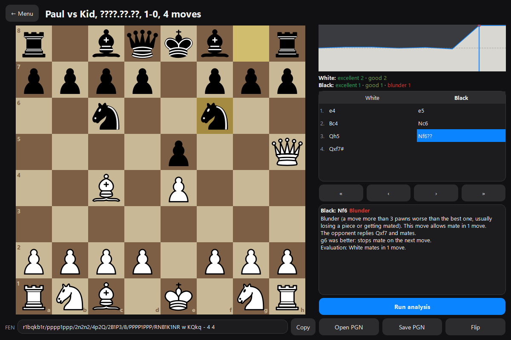

# Chessiss

Chess for Windows with a coach that explains every move: how it changed the evaluation, which move was better and why. The explanations are built from Stockfish analysis using templates, with no neural networks and no internet connection.


## Features

- Play against Stockfish, levels 1-20, with an explanation of every move. Before your move you can ask for a hint: up to three candidates, each with a reason.
- Two-player mode on one computer.
- Time controls: Bullet, Blitz, Rapid, Classical, custom (minutes and increment) or practice without a timer. Running out of time loses the game, or draws it if the opponent has no mating material.
- 600 tactical puzzles: forks, pins, mate in 1, 2 and 3, winning material.
- Game review with move marks (excellent, good, inaccuracy, mistake, blunder) and an evaluation graph. Games can be loaded from PGN.
- Game history with filters, PGN import and export, and win/draw/loss statistics for your games against the AI.
- An interrupted game can be resumed after a restart.
- Dark and light themes.
- English and Russian interface, switchable in Settings without a restart.





## Download

A portable build is available in the [v1.1.0 release](https://github.com/gerankamirovitch/Chessiss/releases/tag/v1.1.0). Unzip the archive and run `Chessiss\Chessiss.exe`. There is nothing to install, and Stockfish is included. The file is not signed, so Windows may show a warning on the first launch.

Games, puzzles and settings are stored in `%LOCALAPPDATA%\Chessiss`, so you can replace the program folder and keep your data.

## Run from source

You need Python 3 and Windows x64.

```powershell
git clone https://github.com/gerankamirovitch/Chessiss.git
cd Chessiss
python -m venv .venv
.\.venv\Scripts\python.exe -m pip install -r requirements.txt
.\.venv\Scripts\python.exe scripts\fetch_stockfish.py
.\.venv\Scripts\python.exe main.py
```

`scripts/fetch_stockfish.py` downloads Stockfish 19 to `~/Downloads`, verifies its SHA-256 and places it in `engines/stockfish/`. The binary is not stored in the repository. You can point the app at another Stockfish in Settings.

## Tests

```powershell
.\.venv\Scripts\python.exe -m pip install -r requirements-dev.txt
.\.venv\Scripts\python.exe -m pytest tests -q
```

Tests that need the engine are skipped if there is no Stockfish in `engines/stockfish/`. A full run takes about five minutes.

## Build

```powershell
.\.venv\Scripts\python.exe scripts\build.py
```

The result is the `dist\Chessiss` folder (PyInstaller, onedir) with Stockfish inside. Run `scripts/fetch_stockfish.py` before building.

## Project layout

```text
core/      rules, clock, Stockfish wrapper, explanation generator, PGN, translations
storage/   SQLite: games, moves, puzzles, settings
ui/        PySide6 windows, no chess logic
net/       empty, reserved for an online mode
scripts/   Stockfish download, puzzle set build, exe build
data/      puzzles.json
tests/     pytest
```

## Limitations

- Tested on Windows 11 x64 only. The app has not been run on Windows 10.
- Move explanations saved in one language are not translated. After switching language, run the analysis again to get them in the new one.
- If you undo moves made before an interrupted game was restored, the time spent on them is not returned.

## Licenses

Chessiss is distributed under GPLv3, see [LICENSE](LICENSE).

- [Stockfish](https://stockfishchess.org/) 19, GPLv3. It runs as a separate process over the UCI protocol.
- [python-chess](https://github.com/niklasf/python-chess), GPLv3.
- [PySide6](https://doc.qt.io/qtforpython-6/), LGPLv3.
- The puzzles come from the [Lichess database](https://database.lichess.org/#puzzles), CC0.
