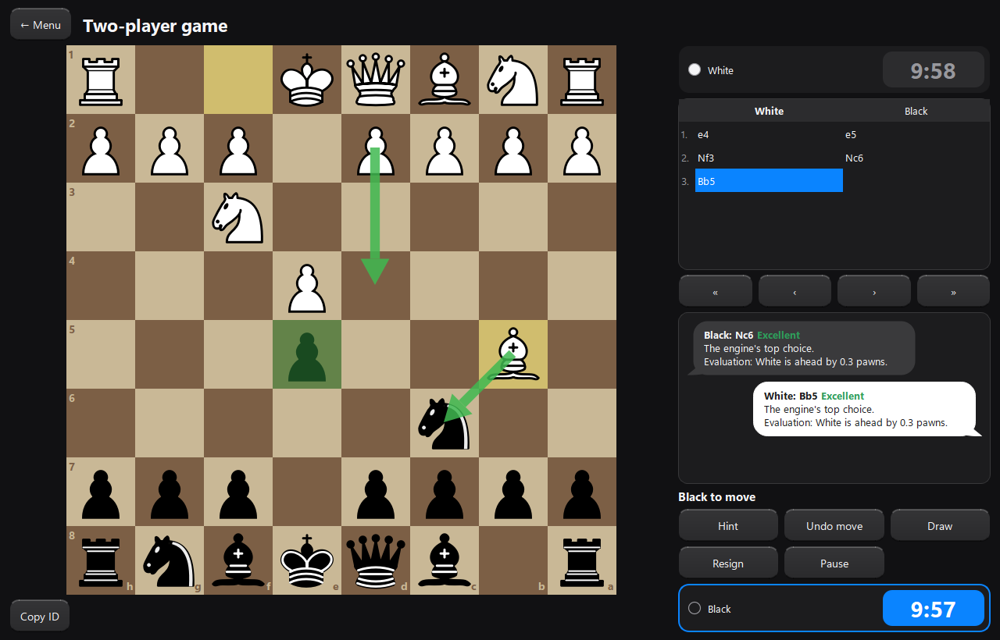
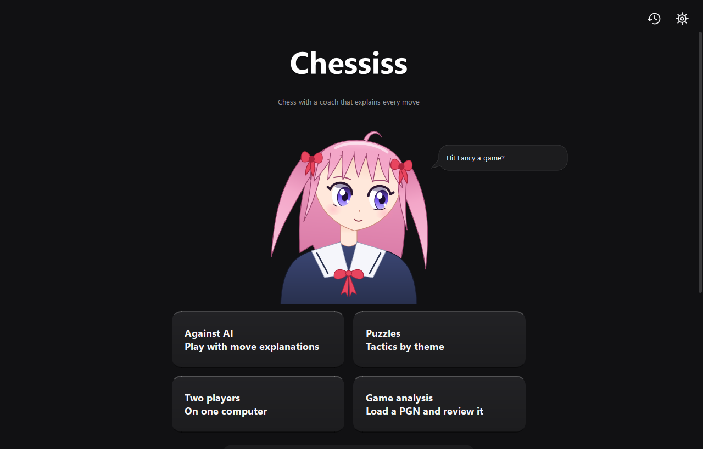
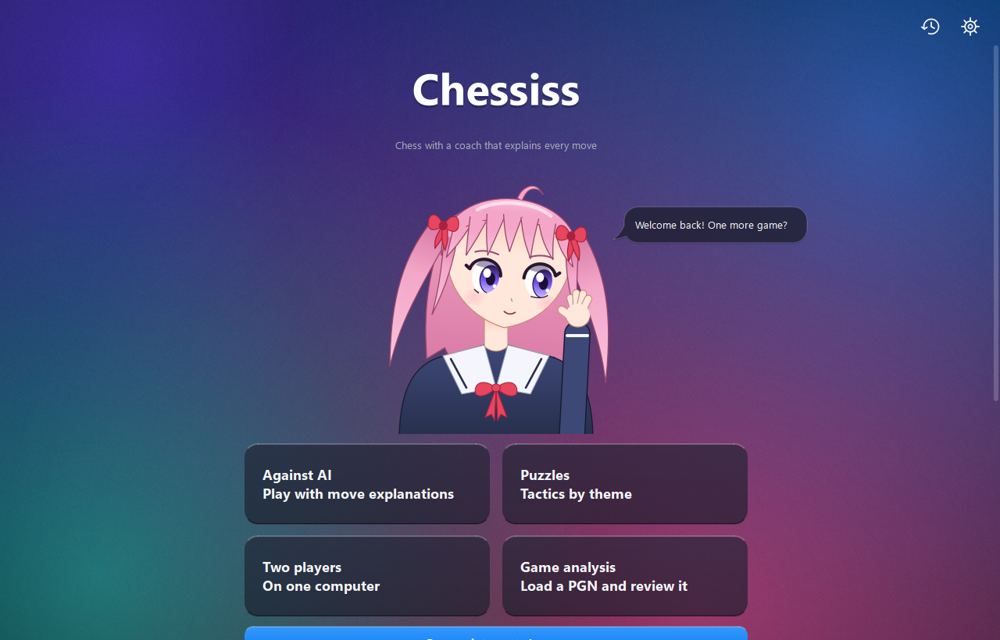
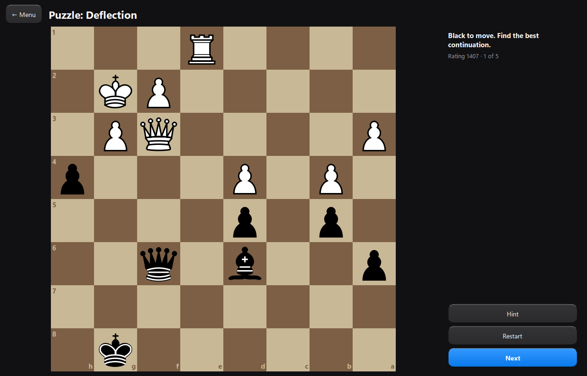

# Chessiss

Chess for Windows with a coach that explains every move: how it changed the evaluation, which move was better and why. The explanations are built from Stockfish analysis using templates, with no neural networks and no internet connection.



## Download

Grab `Chessiss-1.2.0-windows-x64.zip` from the [v1.2.0 release](https://github.com/gerankamirovitch/Chessiss/releases/tag/v1.2.0), unzip it and run `Chessiss\Chessiss.exe`. There is nothing to install: no Python, and Stockfish is included. The file is not signed, so Windows may show a warning on the first launch.

Games, puzzles and settings are stored in `%LOCALAPPDATA%\Chessiss`, so you can replace the program folder and keep your data. Data from older versions opens in the new one.

## Features

- Play against Stockfish, levels 1-20, with an explanation of every move. Before your move you can ask for a hint: up to three candidates, each with a reason.
- Two-player mode on one computer. After every move, and after every undo, the board turns round with a short animation so that the side to move plays from the bottom. The player cards show whose turn it is and blink once when they trade places.
- Explanations appear as a chat: your moves on the right in white bubbles, the opponent's on the left in dark ones.
- Draw arrows and mark squares with the right mouse button, to think a position through. They never affect the game, and a left click clears them.
- Time controls: Bullet, Blitz, Rapid, Classical, custom (minutes and increment) or practice without a timer. Running out of time loses the game, or draws it if the opponent has no mating material.
- 2,817 tactical puzzles in 18 themes (mate in 1-4, back-rank mate, fork, pin, skewer, discovered attack, double check, deflection, attraction, sacrifice, quiet move, zugzwang, promotion, endgame, winning material), rated 1400-2800. Each puzzle comes from a different game, and "Next" skips the ones you have solved.
- Game review with move marks (excellent, good, inaccuracy, mistake, blunder) and an evaluation graph. Games can be loaded from PGN.
- Game history with filters, PGN import and export, and win/draw/loss statistics for your games.
- An interrupted game can be resumed after a restart. "Copy ID" copies the position's FEN.
- Three themes: light, dark and liquid glass (translucent panels over a painted backdrop; it follows the Windows light or dark mode).
- Four move sounds, chosen in Settings: wood (the knock of a piece on a board), classic, bubble and 8-bit. All of them are generated by the program.
- An animated "Chessiss" title and a mascot on the home screen. Her head and eyes follow the cursor, and her hair has its own physics.
- English and Russian interface, switchable in Settings without a restart.







## Run from source

You need Python 3 and Windows x64.

```powershell
git clone https://github.com/gerankamirovitch/Chessiss.git
cd Chessiss
python -m venv .venv
.\.venv\Scripts\python.exe -m pip install -r requirements.txt
.\.venv\Scripts\python.exe scripts\fetch_stockfish.py
.\.venv\Scripts\python.exe main.py
```

`scripts/fetch_stockfish.py` downloads Stockfish 19 to `~/Downloads`, verifies its SHA-256 and places it in `engines/stockfish/`. The binary is not stored in the repository. You can point the app at another Stockfish in Settings.

## Tests

```powershell
.\.venv\Scripts\python.exe -m pip install -r requirements-dev.txt
.\.venv\Scripts\python.exe -m pytest tests -q
```

Tests that need the engine are skipped if there is no Stockfish in `engines/stockfish/`. A full run takes about 40 minutes, most of it in the interface tests that play real games.

## Build

```powershell
.\.venv\Scripts\python.exe scripts\build.py
```

The result is the `dist\Chessiss` folder (PyInstaller, onedir) with Stockfish inside. Run `scripts/fetch_stockfish.py` before building. `scripts/build_puzzles.py` rebuilds `data/puzzles.json` from the Lichess database.

## Project layout

```text
core/      rules, clock, Stockfish wrapper, explanation generator, PGN, translations
storage/   SQLite: games, moves, puzzles, settings
ui/        PySide6 windows, board, chat, mascot, title, themes; no chess logic
net/       empty, reserved for an online mode
scripts/   Stockfish download, puzzle set build, exe build
data/      puzzles.json
tests/     pytest
```

## Limitations

- Tested on Windows 11 x64 only. The app has not been run on Windows 10.
- Move explanations saved in one language are not translated. After switching language, run the analysis again to get them in the new one.
- If you undo moves made before an interrupted game was restored, the time spent on them is not returned.
- The liquid glass theme does not blur what is behind the window. It is a painted backdrop under translucent panels.
- The sounds are synthesized, so they sound simpler than recordings.
- One automatic test (`test_review_of_a_game_played_past_threefold_has_no_false_blunders`) fails in roughly one run in three: a game review can mark a king move as a blunder in a position that is already won.

## Licenses

Chessiss is distributed under GPLv3, see [LICENSE](LICENSE).

- [Stockfish](https://stockfishchess.org/) 19, GPLv3. It runs as a separate process over the UCI protocol.
- [python-chess](https://github.com/niklasf/python-chess), GPLv3.
- [PySide6](https://doc.qt.io/qtforpython-6/), LGPLv3.
- The puzzles come from the [Lichess database](https://database.lichess.org/#puzzles), CC0.
- The mascot and the title animation are drawn by the program itself, with no image files.

---

## По-русски

Chessiss это шахматы для Windows с тренером, который объясняет каждый ход: как он изменил оценку, какой ход был лучше и почему. Объяснения строятся по шаблонам из анализа Stockfish, без нейросетей и интернета.

**Скачать:** архив `Chessiss-1.2.0-windows-x64.zip` из [релиза v1.2.0](https://github.com/gerankamirovitch/Chessiss/releases/tag/v1.2.0), распаковать и запустить `Chessiss\Chessiss.exe`. Ставить Python не нужно, Stockfish внутри. Файл не подписан, поэтому Windows может показать предупреждение при первом запуске. Партии и настройки лежат в `%LOCALAPPDATA%\Chessiss`.

**Что есть:** игра против Stockfish (уровни 1-20) с объяснением ходов и подсказками; игра вдвоём, где доска сама поворачивается после каждого хода; объяснения в виде чата; стрелки и подсветка клеток правой кнопкой мыши; 2817 пазлов в 18 темах; разбор партий и импорт PGN; история и статистика; три темы (светлая, тёмная, «Жидкое стекло»); четыре звука хода; анимированный логотип и девушка-маскот, которая следит за курсором; интерфейс на русском и английском.

**Ограничения:** проверено только на Windows 11 x64; сохранённые объяснения не переводятся при смене языка; «Жидкое стекло» не размывает то, что за окном. Лицензия GPLv3.
